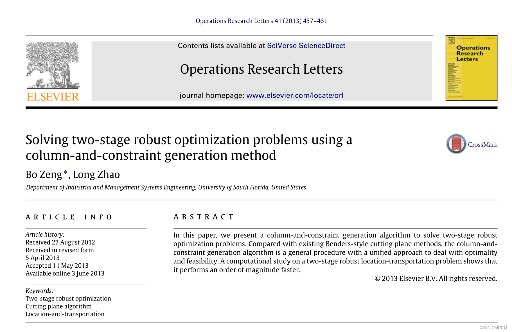
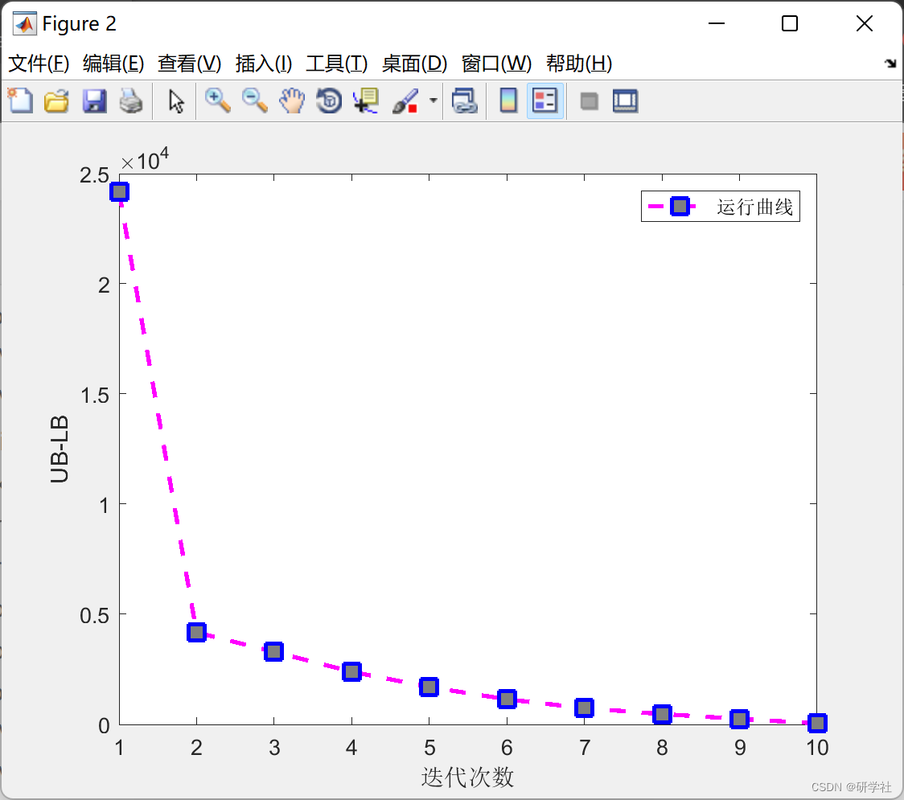

# Two-stage Robust Optimization Problem in Microgrids (Matlab Code Implementation)

🏆 Bloggers' Advantage: 🌞🌞🌞 The content of the blog strives for rigorous thinking and clear logic to facilitate readers.
⛳️ Mantra: A journey of a thousand miles is begun with a single step.
📋📋📋 This article is organized as follows: 🎁🎁🎁 Table of Contents
💥1 Overview📚2 Run Results🎉3 References🌈4 Matlab Code and Extensive Explanation of the Article
📊📊📊 Edit: Overview of References:
Standing on the shoulders of giants!!!! Editor
📊📊📊 Edit
Robust Optimization (RO) is a recent method for handling data uncertainty. Since it is derived from hedged against any disturbances in the input data, the solutions of the (single-stage) RO model tend to be overly conservative. To address this issue, two-stage RO (as well as more general multi-level RO) has been introduced and studied, also known as Robust Tunable or Adaptive Optimization [3], where the second stage problem is modeled after the decision making made in the first stage and revealed the uncertainty. Due to improved modeling capabilities, two-stage RO has become a popular decision tool. Applications include network/transport problems, combinatorial optimization, and power system dispatch problems.
In recent years, China's wind power development has been rapid, becoming one of the main sources of electricity in China. By 2020, China's installed wind power capacity will account for a significant proportion of total installed capacity. The large-scale centralized development and integration of wind power have had a serious impact on China's power grid operation. Unlike traditional energy sources, wind power output is uncertain. In February 2008, a large-scale ramp event occurred in Texas, USA, leading to load reduction incidents [1]; in June 2008, New York's Upper State was hit by a storm that caused all 250MW wind farms to shut down within 8 minutes [2]. If traditional day-ahead dispatch methods were still used, the power system would face significant risks.
Considering the uncertainty of wind power output, the unit commitment problem essentially involves the issue of system's capacity adequacy. Currently, there has been a significant amount of research on this topic, including scenario-based unit commitment, opportunity-constrained unit commitment, and robust unit commitment. The opportunity-constrained unit commitment model is non-convex due to its inclusion of opportunity constraints, making it difficult to solve directly. Although scenario-based unit commitment offers good economic performance, the model considers a large set of wind power output scenarios, leading to a large-scale model that is challenging to solve. To address this issue, [10] proposes considering wind power in interval unit commitment. While interval unit commitment can solve quickly, it cannot handle stochastic optimization with discrete random variables such as line outages. Robust unit commitment effectively addresses these issues while ensuring system robustness, and can be solved using methods like Benders decomposition and column generation algorithms (C&CG) for high computational efficiency, making it widely adopted. Due to the conservative nature of robust scheduling results, [12] introduces weak robust theory to sacrifice robustness for improved economic performance. [13] combines scenario-based unit commitment with robust unit commitment to reduce the conservative nature of robust unit commitment.
📚2 Running Results​Edit  
CPXPARAM_MIP_Display              1  
Tried aggregator 1 time.  
MIP Presolve eliminated 779 rows and 47 columns.  
MIP Presolve modified 576 coefficients.
Reduced MIP has 1823 rows, 1110 columns, and 9311 nonzeros.  
Reduced MIP has 192 binaries, 0 generals, 0 SOSs, and 0 indicators.  
Presolve time = 0.00 sec. (5.00 ticks)  
Probing fixed 0 vars, tightened 11 bounds.  
Probing time = 0.00 sec. (1.69 ticks)  
Tried aggregator 1 time.  
Reduced MIP has 1823 rows, 1110 columns, and 9311 nonzeros.  
Reduced MIP has 192 binaries, 0 generals, 0 SOSs, and 0 indicators.  
Presolve time = 0.02 sec. (3.87 ticks)  
Probing time = 0.00 sec. (1.59 ticks)  
MIP emphasis: balance optimality and feasibility.  
MIP search method: dynamic search.  
Parallel mode: deterministic, using up to 16 threads.  
Node log . . .  
Best integer = 1.558508e+06 Node =   0 Best node = 2.128983e+04  
Best integer = 5.306653e+04 Node =   0 Best node = 2.128983e+04  
Best integer = 4.746628e+04 Node =   0 Best node = 4.745700e+04  
Best integer = 4.746130e+04 Node =   0 Best node = 4.745700e+04  
Implied bound cuts applied: 3  
Mixed integer rounding cuts applied: 6  
Gomory fractional cuts applied: 5  
CPXPARAM_MIP_Display              1  
Tried aggregator 3 times.  
MIP Presolve eliminated 3609 rows and 1057 columns.  
MIP Presolve modified 3183 coefficients.  
Aggregator did 61 substitutions.  
Reduced MIP has 3054 rows, 2726 columns, and 21043 nonzeros.  
Reduced MIP has 1318 binaries, 0 generals, 0 SOSs, and 0 indicators.  
Presolve time = 0.02 sec. (30.72 ticks)  
Probing fixed 3 vars, tightened 122 bounds.  
Probing time = 0.02 sec. (1.13 ticks)  
Tried aggregator 3 times.  
MIP Presolve eliminated 129 rows and 103 columns.  
MIP Presolve modified 618 coefficients.  
Aggregator did 79 substitutions.  
Reduced MIP has 2846 rows, 2544 columns, and 20519 nonzeros.  
Reduced MIP has 1201 binaries, 1 generals, 0 SOSs, and 0 indicators.  
Presolve time = 0.02 sec. (24.01 ticks)  
Probing time = 0.00 sec. (1.04 ticks)  
MIP emphasis: balance optimality and feasibility.  
MIP search method: dynamic search.  
Parallel mode: deterministic, using up to 16 threads.  
Node log . . .  
Best integer = -1.749242e+04 Node =   0 Best node = -2.422582e+04  
Best integer = -1.769821e+04 Node =   0 Best node = -2.422582e+04  
Best integer = -2.418924e+04 Node =   0 Best node = -2.422582e+04  
Clique cuts applied: 12  
Cover cuts applied: 6  
Implied bound cuts applied: 52  
Mixed integer rounding cuts applied: 151  
Gomory fractional cuts applied: 52  
CPXPARAM_MIP_Display              1  
Tried aggregator 2 times.  
MIP Presolve eliminated 829 rows and 2 columns.  
MIP Presolve modified 1008 coefficients.  
Aggregator did 144 substitutions.  
Reduced MIP has 1053 rows, 723 columns, and 7241 nonzeros.  
Reduced MIP has 192 binaries, 0 generals, 0 SOSs, and 0 indicators.  
Presolve time = 0.00 sec. (7.29 ticks)  
Probing fixed 0 vars, tightened 24 bounds.  
Probing time = 0.00 sec. (0.53 ticks)  
Tried aggregator 1 time.  
MIP Presolve eliminated 144 rows and 72 columns.  
Reduced MIP has 909 rows, 651 columns, and 6953 nonzeros.  
Reduced MIP has 120 binaries, 0 generals, 0 SOSs, and 0 indicators.  
Presolve time = 0.00 sec. (3.64 ticks)  
Probing time = 0.00 sec. (0.26 ticks)  
MIP emphasis: balance optimality and feasibility.  
MIP search method: dynamic search.  
Parallel mode: deterministic, using up to 16 threads.  
Node log . . .  
Best integer = 1.435047e+06 Node =   0 Best node = 4.559537e+04  
Best integer = 1.601358e+05 Node =   0 Best node = 4.559537e+04  
Best integer = 6.747812e+04 Node =   0 Best node = 6.747487e+04  
CPXPARAM_MIP_Display              1  
Tried aggregator 3 times.  
MIP Presolve eliminated 3639 rows and 1096 columns.  
MIP Presolve modified 3189 coefficients.  
Aggregator did 60 substitutions.  
Reduced MIP has 3025 rows, 2688 columns, and 20940 nonzeros.  
Reduced MIP has 1306 binaries, 0 generals, 0 SOSs, and 0 indicators.  
Presolve time = 0.02 sec. (30.45 ticks)  
Probing fixed 2 vars, tightened 129 bounds.  
Probing time = 0.00 sec. (1.35 ticks)  
Tried aggregator 3 times.  
MIP Presolve eliminated 145 rows and 116 columns.  
MIP Presolve modified 592 coefficients.  
Aggregator did 73 substitutions.  
Reduced MIP has 2807 rows, 2499 columns, and 20394 nonzeros.  
Reduced MIP has 1187 binaries, 1 generals, 0 SOSs, and 0 indicators.  
Presolve time = 0.02 sec. (23.83 ticks)  
Probing fixed 0 vars, tightened 2 bounds.  
Probing time = 0.00 sec. (1.22 ticks)  
MIP emphasis: balance optimality and feasibility.  
MIP search method: dynamic search.  
Parallel mode: deterministic, using up to 16 threads.  
Node log . . .  
Best integer = -2.149270e+04 Node =   0 Best node = -2.676388e+04  
Best integer = -2.181844e+04 Node =   0 Best node = -2.676289e+04  
Clique cuts applied: 16  
Cover cuts applied: 23  
Implied bound cuts applied: 100  
Flow cuts applied: 7  
Mixed integer rounding cuts applied: 143  
Gomory fractional cuts applied: 60  
CPXPARAM_MIP_Display              1  
Tried aggregator 2 times.  
MIP Presolve eliminated 829 rows and 2 columns.  
MIP Presolve modified 1008 coefficients.  
Aggregator did 144 substitutions.  
Reduced MIP has 1053 rows, 723 columns, and 7241 nonzeros.  
Reduced MIP has 192 binaries, 0 generals, 0 SOSs, and 0 indicators.  
Presolve time = 0.00 sec. (7.29 ticks)  
Probing fixed 0 vars, tightened 24 bounds.  
Probing time = 0.02 sec. (0.50 ticks)  
Tried aggregator 1 time.  
MIP Presolve eliminated 144 rows and 72 columns.  
Reduced MIP has 909 rows, 651 columns, and 6953 nonzeros.  
Reduced MIP has 120 binaries, 0 generals, 0 SOSs, and 0 indicators.  
Presolve time = 0.00 sec. (3.64 ticks)  
Probing time = 0.00 sec. (0.22 ticks)  
MIP emphasis: balance optimality and feasibility.  
MIP search method: dynamic search.  
Parallel mode: deterministic, using up to 16 threads.  
Node log . . .  
Best integer = 1.434795e+06 Node =   0 Best node = 4.387395e+04  
Best integer = 1.597238e+05 Node =   0 Best node = 4.387395e+04  
Best integer = 6.835990e+04 Node =   0 Best node = 6.835665e+04  
CPXPARAM_MIP_Display              1  
Tried aggregator 3 times.  
MIP Presolve eliminated 3833 rows and 1275 columns.  
MIP Presolve modified 3181 coefficients.  
Aggregator did 67 substitutions.  
Reduced MIP has 2824 rows, 2502 columns, and 20363 nonzeros.  
Reduced MIP has 1221 binaries, 0 generals, 0 SOSs, and 0 indicators.  
Presolve time = 0.02 sec. (30.34 ticks)  
Probing fixed 0 vars, tightened 97 bounds.  
Probing time = 0.00 sec. (1.31 ticks)  
Tried aggregator 3 times.  
MIP Presolve eliminated 137 rows and 108 columns.  
MIP Presolve modified 552 coefficients.  
Aggregator did 61 substitutions.  
Reduced MIP has 2626 rows, 2333 columns, and 19897 nonzeros.  
Reduced MIP has 1122 binaries, 3 generals, 0 SOSs, and 0 indicators.  
Presolve time = 0.02 sec. (19.99 ticks)  
Probing time = 0.00 sec. (1.14 ticks)  
MIP emphasis: balance optimality and feasibility.  
MIP search method: dynamic search.  
Parallel mode: deterministic, using up to 16 threads.  
Node log . . .  
Best integer = -2.439674e+04 Node =   0 Best node = -2.890634e+04  
Best integer = -2.886494e+04 Node =  524 Best node = -2.890295e+04  
Clique cuts applied: 16  
Cover cuts applied: 16  
Implied bound cuts applied: 31  
Flow cuts applied: 7  
Mixed integer rounding cuts applied: 100  
Gomory fractional cuts applied: 56  
CPXPARAM_MIP_Display              1  
Tried aggregator 2 times.  
MIP Presolve eliminated 829 rows and 2 columns.  
MIP Presolve modified 1008 coefficients.  
Aggregator did 144 substitutions.  
Reduced MIP has 1053 rows, 723 columns, and 7241 nonzeros.  
Reduced MIP has 192 binaries, 0 generals, 0 SOSs, and 0 indicators.  
Presolve time = 0.00 sec. (7.29 ticks)  
Probing fixed 0 vars, tightened 24 bounds.  
Probing time = 0.02 sec. (0.49 ticks)  
Tried aggregator 1 time.  
MIP Presolve eliminated 144 rows and 72 columns.  
Reduced MIP has 909 rows, 651 columns, and 6953 nonzeros.  
Reduced MIP has 120 binaries, 0 generals, 0 SOSs, and 0 indicators.  
Presolve time = 0.00 sec. (3.64 ticks)  
Probing time = 0.00 sec. (0.22 ticks)  
MIP emphasis: balance optimality and feasibility.  
MIP search method: dynamic search.  
Parallel mode: deterministic, using up to 16 threads.  
Node log . . .  
Best integer = 1.435291e+06 Node =   0 Best node = 4.228469e+04  
Best integer = 1.616469e+05 Node =   0 Best node = 4.228469e+04  
Best integer = 6.925787e+04 Node =   0 Best node = 6.925463e+04  
CPXPARAM_MIP_Display              1  
Tried aggregator 3 times.  
MIP Presolve eliminated 3924 rows and 1372 columns.  
MIP Presolve modified 3186 coefficients.  
Aggregator did 72 substitutions.  
Reduced MIP has 2728 rows, 2400 columns, and 20066 nonzeros.  
Reduced MIP has 1180 binaries, 0 generals, 0 SOSs, and 0 indicators.  
Presolve time = 0.00 sec. (30.04 ticks)  
Probing fixed 0 vars, tightened 82 bounds.  
Probing time = 0.00 sec. (1.30 ticks)  
Tried aggregator 1 time.  
MIP Presolve eliminated 150 rows and 120 columns.  
MIP Presolve modified 451 coefficients.  
Reduced MIP has 2578 rows, 2280 columns, and 19692 nonzeros.  
Reduced MIP has 1130 binaries, 6 generals, 0 SOSs, and 0 indicators.  
Presolve time = 0.02 sec. (8.66 ticks)  
Probing time = 0.00 sec. (1.16 ticks)  
MIP emphasis: balance optimality and feasibility.  
MIP search method: dynamic search.  
Parallel mode: deterministic, using up to 16 threads.  
Node log . . .  
Best integer = -3.044507e+04 Node =   0 Best node = -3.202296e+04  
Best integer = -3.044582e+04 Node =   0 Best node = -3.093878e+04  
Best integer = -3.044609e+04 Node =   0 Best node = -3.089980e+04  
Best integer = -3.050281e+04 Node =   0 Best node = -3.089980e+04  
Clique cuts applied: 12  
Cover cuts applied: 44  
Implied bound cuts applied: 19  
Flow cuts applied: 7  
Mixed integer rounding cuts applied: 53  
Gomory fractional cuts applied: 28  
CPXPARAM_MIP_Display              1  
Tried aggregator 2 times.  
MIP Presolve eliminated 829 rows and 2 columns.  
MIP Presolve modified 1008 coefficients.  
Aggregator did 144 substitutions.  
Reduced MIP has 1053 rows, 723 columns, and 7241 nonzeros.  
Reduced MIP has 192 binaries, 0 generals, 0 SOSs, and 0 indicators.  
Presolve time = 0.00 sec. (7.29 ticks)  
Probing fixed 0 vars, tightened 24 bounds.  
Probing time = 0.00 sec. (0.48 ticks)  
Tried aggregator 1 time.  
MIP Presolve eliminated 144 rows and 72 columns.  
Reduced MIP has 909 rows, 651 columns, and 6953 nonzeros.  
Reduced MIP has 120 binaries, 0 generals, 0 SOSs, and 0 indicators.  
Presolve time = 0.02 sec. (3.64 ticks)  
Probing time = 0.00 sec. (0.21 ticks)  
MIP emphasis: balance optimality and feasibility.  
MIP search method: dynamic search.  
Parallel mode: deterministic, using up to 16 threads.  
Node log . . .  
Best integer = 1.435399e+06 Node =   0 Best node = 4.081637e+04  
Best integer = 1.629365e+05 Node =   0 Best node = 4.081637e+04  
Best integer = 6.995436e+04 Node =   0 Best node = 6.995241e+04  
CPXPARAM_MIP_Display              1  
Tried aggregator 3 times.  
MIP Presolve eliminated 3888 rows and 1329 columns.  
MIP Presolve modified 3183 coefficients.  
Aggregator did 72 substitutions.  
Reduced MIP has 2764 rows, 2443 columns, and 20191 nonzeros.  
Reduced MIP has 1195 binaries, 0 generals, 0 SOSs, and 0 indicators.  
Presolve time = 0.00 sec. (30.24 ticks)  
Probing fixed 1 vars, tightened 95 bounds.  
Probing time = 0.02 sec. (1.36 ticks)  
Tried aggregator 3 times.  
MIP Presolve eliminated 143 rows and 113 columns.  
MIP Presolve modified 522 coefficients.  
Aggregator did 51 substitutions.  
Reduced MIP has 2570 rows, 2279 columns, and 19730 nonzeros.  
Reduced MIP has 1102 binaries, 6 generals, 0 SOSs, and 0 indicators.  
Presolve time = 0.03 sec. (19.77 ticks)  
Probing time = 0.00 sec. (1.23 ticks)  
MIP emphasis: balance optimality and feasibility.  
MIP search method: dynamic search.  
Parallel mode: deterministic, using up to 16 threads.  
Node log . . .  
Best integer = -3.229320e+04 Node =   0 Best node = -3.386904e+04  
Best integer = -3.229448e+04 Node =   0 Best node = -3.274230e+04  
Best integer = -3.231160e+04 Node =   36 Best node = -3.273753e+04  
Best integer = -3.267385e+04 Node =  527 Best node = -3.273693e+04  
Clique cuts applied: 10  
Cover cuts applied: 31  
Implied bound cuts applied: 27  
Flow cuts applied: 2  
Mixed integer rounding cuts applied: 50  
Gomory fractional cuts applied: 31  
CPXPARAM_MIP_Display              1  
Tried aggregator 2 times.  
MIP Presolve eliminated 829 rows and 2 columns.  
MIP Presolve modified 1008 coefficients.  
Aggregator did 144 substitutions.  
Reduced MIP has 1053 rows, 723 columns, and 7241 nonzeros.  
Reduced MIP has 192 binaries, 0 generals, 0 SOSs, and 0 indicators.  
Presolve time = 0.00 sec. (7.29 ticks)  
Probing fixed 0 vars, tightened 24 bounds.  
Probing time = 0.00 sec. (0.46 ticks)  
Tried aggregator 1 time.  
MIP Presolve eliminated 144 rows and 72 columns.  
Reduced MIP has 909 rows, 651 columns, and 6953 nonzeros.  
Reduced MIP has 120 binaries, 0 generals, 0 SOSs, and 0 indicators.  
Presolve time = 0.00 sec. (3.64 ticks)  
Probing time = 0.02 sec. (0.19 ticks)  
MIP emphasis: balance optimality and feasibility.  
MIP search method: dynamic search.  
Parallel mode: deterministic, using up to 16 threads.  
Node log . . .  
Best integer = 1.435498e+06 Node =   0 Best node = 3.945881e+04  
Best integer = 1.641265e+05 Node =   0 Best node = 3.945881e+04  
Best integer = 7.050950e+04 Node =   0 Best node = 7.050625e+04  
CPXPARAM_MIP_Display              1  
Tried aggregator 3 times.  
MIP Presolve eliminated 3969 rows and 1400 columns.  
MIP Presolve modified 3173 coefficients.  
Aggregator did 73 substitutions.  
Reduced MIP has 2682 rows, 2371 columns, and 19965 nonzeros.  
Reduced MIP has 1161 binaries, 0 generals, 0 SOSs, and 0 indicators.  
Presolve time = 0.00 sec. (30.19 ticks)  
Probing fixed 1 vars, tightened 86 bounds.  
Probing time = 0.02 sec. (1.35 ticks)  
Tried aggregator 3 times.  
MIP Presolve eliminated 143 rows and 113 columns.  
MIP Presolve modified 482 coefficients.  
Aggregator did 41 substitutions.  
Reduced MIP has 2498 rows, 2217 columns, and 19535 nonzeros.  
Reduced MIP has 1078 binaries, 10 generals, 0 SOSs, and 0 indicators.  
Presolve time = 0.02 sec. (19.45 ticks)  
Probing time = 0.02 sec. (1.27 ticks)  
MIP emphasis: balance optimality and feasibility.  
MIP search method: dynamic search.  
Parallel mode: deterministic, using up to 16 threads.  
Node log . . .  
Best integer = -3.433272e+04 Node =   0 Best node = -3.434461e+04  
Clique cuts applied: 23  
Cover cuts applied: 19  
Implied bound cuts applied: 64  
Flow cuts applied: 19  
Mixed integer rounding cuts applied: 91  
Gomory fractional cuts applied: 51  
CPXPARAM_MIP_Display              1  
Tried aggregator 2 times.  
MIP Presolve eliminated 829 rows and 2 columns.  
MIP Presolve modified 1008 coefficients.  
Aggregator did 144 substitutions.  
Reduced MIP has 1053 rows, 723 columns, and 7241 nonzeros.  
Reduced MIP has 192 binaries, 0 generals, 0 SOSs, and 0 indicators.  
Presolve time = 0.02 sec. (7.29 ticks)  
Probing fixed 0 vars, tightened 24 bounds.  
Probing time = 0.00 sec. (0.46 ticks)  
Tried aggregator 1 time.  
MIP Presolve eliminated 144 rows and 72 columns.  
Reduced MIP has 909 rows, 651 columns, and 6953 nonzeros.  
Reduced MIP has 120 binaries, 0 generals, 0 SOSs, and 0 indicators.  
Presolve time = 0.00 sec. (3.64 ticks)  
Probing time = 0.00 sec. (0.19 ticks)  
MIP emphasis: balance optimality and feasibility.  
MIP search method: dynamic search.  
Parallel mode: deterministic, using up to 16 threads.  
Node log . . .  
Best integer = 1.435587e+06 Node =   0 Best node = 3.820272e+04  
Best integer = 1.652181e+05 Node =   0 Best node = 3.820272e+04  
Best integer = 7.091213e+04 Node =   0 Best node = 7.090888e+04  
CPXPARAM_MIP_Display              1  
Tried aggregator 3 times.  
MIP Presolve eliminated 4084 rows and 1509 columns.  
MIP Presolve modified 3167 coefficients.  
Aggregator did 80 substitutions.  
Reduced MIP has 2560 rows, 2255 columns, and 19615 nonzeros.  
Reduced MIP has 1109 binaries, 0 generals, 0 SOSs, and 0 indicators.  
Presolve time = 0.02 sec. (30.05 ticks)  
Probing fixed 1 vars, tightened 69 bounds.  
Probing time = 0.00 sec. (1.38 ticks)  
Tried aggregator 3 times.  
MIP Presolve eliminated 149 rows and 117 columns.  
MIP Presolve modified 435 coefficients.  
Aggregator did 31 substitutions.  
Reduced MIP has 2380 rows, 2107 columns, and 19204 nonzeros.  
Reduced MIP has 1037 binaries, 14 generals, 0 SOSs, and 0 indicators.  
Presolve time = 0.02 sec. (21.84 ticks)  
Probing time = 0.02 sec. (1.32 ticks)  
MIP emphasis: balance optimality and feasibility.  
MIP search method: dynamic search.  
Parallel mode: deterministic, using up to 16 threads.  
Node log . . .  
Best integer = -3.531202e+04 Node =   0 Best node = -3.670811e+04  
Clique cuts applied: 15  
Cover cuts applied: 47  
Implied bound cuts applied: 57  
Flow cuts applied: 14  
Mixed integer rounding cuts applied: 102  
Gomory fractional cuts applied: 72  
CPXPARAM_MIP_Display              1  
Tried aggregator 2 times.  
MIP Presolve eliminated 829 rows and 2 columns.  
MIP Presolve modified 1008 coefficients.  
Aggregator did 144 substitutions.  
Reduced MIP has 1053 rows, 723 columns, and 7241 nonzeros.  
Reduced MIP has 192 binaries, 0 generals, 0 SOSs, and 0 indicators.  
Presolve time = 0.02 sec. (7.29 ticks)  
Probing fixed 0 vars, tightened 24 bounds.  
Probing time = 0.00 sec. (0.45 ticks)  
Tried aggregator 1 time.  
MIP Presolve eliminated 144 rows and 72 columns.  
Reduced MIP has 909 rows, 651 columns, and 6953 nonzeros.  
Reduced MIP has 120 binaries, 0 generals, 0 SOSs, and 0 indicators.  
Presolve time = 0.00 sec. (3.65 ticks)  
Probing time = 0.00 sec. (0.18 ticks)  
MIP emphasis: balance optimality and feasibility.  
MIP search method: dynamic search.  
Parallel mode: deterministic, using up to 16 threads.  
Node log . . .  
Best integer = 1.435666e+06 Node =   0 Best node = 3.703968e+04  
Best integer = 7.123725e+04 Node =   0 Best node = 3.703968e+04  
Best integer = 7.117944e+04 Node =   0 Best node = 7.117749e+04  
CPXPARAM_MIP_Display              1  
Tried aggregator 3 times.  
MIP Presolve eliminated 4124 rows and 1544 columns.  
MIP Presolve modified 3156 coefficients.  
Aggregator did 78 substitutions.  
Reduced MIP has 2522 rows, 2222 columns, and 19509 nonzeros.  
Reduced MIP has 1094 binaries, 0 generals, 0 SOSs, and 0 indicators.  
Presolve time = 0.02 sec. (30.03 ticks)  
Probing fixed 2 vars, tightened 69 bounds.  
Probing time = 0.02 sec. (1.55 ticks)  
Tried aggregator 3 times.  
MIP Presolve eliminated 158 rows and 124 columns.  
MIP Presolve modified 429 coefficients.  
Aggregator did 31 substitutions.  
Reduced MIP has 2333 rows, 2067 columns, and 19089 nonzeros.  
Reduced MIP has 1023 binaries, 17 generals, 0 SOSs, and 0 indicators.  
Presolve time = 0.02 sec. (21.70 ticks)  
Probing time = 0.00 sec. (1.32 ticks)  
MIP emphasis: balance optimality and feasibility.  
MIP search method: dynamic search.  
Parallel mode: deterministic, using up to 16 threads.  
Node log . . .  
Best integer = -3.655283e+04 Node =   0 Best node = -3.786446e+04  
Best integer = -3.692724e+04 Node =   0 Best node = -3.693466e+04  
Clique cuts applied: 16  
Cover cuts applied: 10  
Implied bound cuts applied: 50  
Flow cuts applied: 13  
Mixed integer rounding cuts applied: 96  
Zero-half cuts applied: 1  
Lift and project cuts applied: 1  
Gomory fractional cuts applied: 36  
CPXPARAM_MIP_Display              1  
Tried aggregator 2 times.  
MIP Presolve eliminated 829 rows and 2 columns.  
MIP Presolve modified 1008 coefficients.  
Aggregator did 144 substitutions.  
Reduced MIP has 1053 rows, 723 columns, and 7241 nonzeros.  
Reduced MIP has 192 binaries, 0 generals, 0 SOSs, and 0 indicators.  
Presolve time = 0.02 sec. (7.29 ticks)  
Probing fixed 0 vars, tightened 24 bounds.  
Probing time = 0.00 sec. (0.45 ticks)  
Tried aggregator 1 time.  
MIP Presolve eliminated 144 rows and 72 columns.  
Reduced MIP has 909 rows, 651 columns, and 6953 nonzeros.  
Reduced MIP has 120 binaries, 0 generals, 0 SOSs, and 0 indicators.  
Presolve time = 0.00 sec. (3.65 ticks)  
Probing time = 0.00 sec. (0.18 ticks)  
MIP emphasis: balance optimality and feasibility.  
MIP search method: dynamic search.  
Parallel mode: deterministic, using up to 16 threads.  
Node log . . .  
Best integer = 1.435737e+06 Node =   0 Best node = 3.596200e+04  
Best integer = 7.145608e+04 Node =   0 Best node = 3.596200e+04  
Best integer = 7.139956e+04 Node =   0 Best node = 7.139632e+04  
CPXPARAM_MIP_Display              1  
Tried aggregator 3 times.  
MIP Presolve eliminated 4159 rows and 1563 columns.  
MIP Presolve modified 3122 coefficients.  
Aggregator did 61 substitutions.  
Reduced MIP has 2504 rows, 2220 columns, and 19481 nonzeros.  
Reduced MIP has 1091 binaries, 0 generals, 0 SOSs, and 0 indicators.  
Presolve time = 0.02 sec. (30.08 ticks)  
Probing fixed 1 vars, tightened 66 bounds.  
Probing time = 0.00 sec. (1.43 ticks)  
Tried aggregator 3 times.  
MIP Presolve eliminated 143 rows and 113 columns.  
MIP Presolve modified 416 coefficients.  
Aggregator did 28 substitutions.  
Reduced MIP has 2333 rows, 2079 columns, and 19119 nonzeros.  
Reduced MIP has 1028 binaries, 21 generals, 0 SOSs, and 0 indicators.  
Presolve time = 0.03 sec. (18.87 ticks)  
Probing time = 0.00 sec. (1.35 ticks)  
MIP emphasis: balance optimality and feasibility.  
MIP search method: dynamic search.  
Parallel mode: deterministic, using up to 16 threads.  
Node log . . .  
Best integer = -3.761882e+04 Node =   0 Best node = -3.873746e+04  
Clique cuts applied: 14  
Cover cuts applied: 24  
Implied bound cuts applied: 39  
Flow cuts applied: 7  
Mixed integer rounding cuts applied: 69  
Gomory fractional cuts applied: 49  
CPXPARAM_MIP_Display              1  
Tried aggregator 2 times.  
MIP Presolve eliminated 829 rows and 2 columns.  
MIP Presolve modified 1008 coefficients.  
Aggregator did 144 substitutions.  
Reduced MIP has 1053 rows, 723 columns, and 7241 nonzeros.  
Reduced MIP has 192 binaries, 0 generals, 0 SOSs, and 0 indicators.  
Presolve time = 0.00 sec. (7.29 ticks)  
Probing fixed 0 vars, tightened 24 bounds.  
Probing time = 0.00 sec. (0.45 ticks)  
Tried aggregator 1 time.  
MIP Presolve eliminated 144 rows and 72 columns.  
Reduced MIP has 909 rows, 651 columns, and 6953 nonzeros.  
Reduced MIP has 120 binaries, 0 generals, 0 SOSs, and 0 indicators.  
Presolve time = 0.00 sec. (3.66 ticks)  
Probing time = 0.00 sec. (0.18 ticks)  
MIP emphasis: balance optimality and feasibility.  
MIP search method: dynamic search.  
Parallel mode: deterministic, using up to 16 threads.  
Node log . . .  
Best integer = 1.435804e+06 Node =   0 Best node = 3.496271e+04  
Best integer = 7.166073e+04 Node =   0 Best node = 3.496271e+04  
Best integer = 7.160422e+04 Node =   0 Best node = 7.160097e+04  
CPXPARAM_MIP_Display              1  
Tried aggregator 3 times.  
MIP Presolve eliminated 4184 rows and 1592 columns.  
MIP Presolve modified 3120 coefficients.  
Aggregator did 59 substitutions.  
Reduced MIP has 2481 rows, 2193 columns, and 19405 nonzeros.  
Reduced MIP has 1082 binaries, 0 generals, 0 SOSs, and 0 indicators.  
Presolve time = 0.02 sec. (29.99 ticks)  
Probing fixed 0 vars, tightened 54 bounds.  
Probing time = 0.02 sec. (1.41 ticks)  
Tried aggregator 3 times.  
MIP Presolve eliminated 140 rows and 113 columns.  
MIP Presolve modified 378 coefficients.  
Aggregator did 14 substitutions.  
Reduced MIP has 2327 rows, 2066 columns, and 19068 nonzeros.  
Reduced MIP has 1023 binaries, 23 generals, 0 SOSs, and 0 indicators.  
Presolve time = 0.02 sec. (18.77 ticks)  
Probing time = 0.00 sec. (1.25 ticks)  
MIP emphasis: balance optimality and feasibility.  
MIP search method: dynamic search.  
Parallel mode: deterministic, using up to 16 threads.  
Node log . . .  
Best integer = -3.841269e+04 Node =   0 Best node = -3.942486e+04  
Best integer = -3.869170e+04 Node =   0 Best node = -3.868681e+04  
Clique cuts applied: 13  
Cover cuts applied: 3  
Implied bound cuts applied: 23  
Flow cuts applied: 6  
Mixed integer rounding cuts applied: 94  
Gomory fractional cuts applied: 31  
CPXPARAM_MIP_Display              1  
Tried aggregator 2 times.  
MIP Presolve eliminated 829 rows and 2 columns.  
MIP Presolve modified 1008 coefficients.  
Aggregator did 144 substitutions.  
Reduced MIP has 1053 rows, 723 columns, and 7241 nonzeros.  
Reduced MIP has 192 binaries, 0 generals, 0 SOSs, and 0 indicators.  
Presolve time = 0.00 sec. (7.29 ticks)  
Probing fixed 0 vars, tightened 24 bounds.  
Probing time = 0.00 sec. (0.45 ticks)  
Tried aggregator 1 time.  
MIP Presolve eliminated 144 rows and 72 columns.  
Reduced MIP has 909 rows, 651 columns, and 6953 nonzeros.  
Reduced MIP has 120 binaries, 0 generals, 0 SOSs, and 0 indicators.  
Presolve time = 0.02 sec. (3.67 ticks)  
Probing time = 0.00 sec. (0.18 ticks)  
MIP emphasis: balance optimality and feasibility.  
MIP search method: dynamic search.  
Parallel mode: deterministic, using up to 16 threads.  
Node log . . .  
Best integer = 1.436049e+06 Node =   0 Best node = 3.422789e+04  
Best integer = 7.175970e+04 Node =   0 Best node = 3.422789e+04  
Best integer = 7.170318e+04 Node =   0 Best node = 7.169994e+04  
CPXPARAM_MIP_Display              1  
Tried aggregator 3 times.  
MIP Presolve eliminated 4181 rows and 1592 columns.  
MIP Presolve modified 3115 coefficients.  
Aggregator did 55 substitutions.  
Reduced MIP has 2488 rows, 2197 columns, and 19425 nonzeros.  
Reduced MIP has 1086 binaries, 0 generals, 0 SOSs, and 0 indicators.  
Presolve time = 0.03 sec. (29.92 ticks)  
Probing fixed 1 vars, tightened 57 bounds.  
Probing time = 0.00 sec. (1.40 ticks)  
Tried aggregator 3 times.  
MIP Presolve eliminated 138 rows and 112 columns.  
MIP Presolve modified 381 coefficients.  
Aggregator did 14 substitutions.  
Reduced MIP has 2336 rows, 2071 columns, and 19091 nonzeros.  
Reduced MIP has 1027 binaries, 26 generals, 0 SOSs, and 0 indicators.  
Presolve time = 0.02 sec. (18.81 ticks)  
Probing time = 0.00 sec. (1.43 ticks)  
MIP emphasis: balance optimality and feasibility.  
MIP search method: dynamic search.  
Parallel mode: deterministic, using up to 16 threads.  
Node log . . .  
Best integer = -3.896327e+04 Node =   0 Best node = -3.993966e+04  
Best integer = -3.897429e+04 Node =   0 Best node = -3.923728e+04  
Best integer = -3.914657e+04 Node =   17 Best node = -3.923781e+04  
Clique cuts applied: 10  
Cover cuts applied: 19  
Implied bound cuts applied: 30  
Flow cuts applied: 11  
Mixed integer rounding cuts applied: 60  
Gomory fractional cuts applied: 43  
Time has passed for 39.528332 seconds.  
>>  
🎉3 References  
🌈4 Matlab Code and Article Explanation

## Images

<!-- PAYMENT_BLOCK -->

## Get this dataset

- Payment link (Stripe): [Buy now](https://buy.stripe.com/3cs8yP7sY87d0vu9AB)
- Payment QR code: 

<!-- /PAYMENT_BLOCK -->
